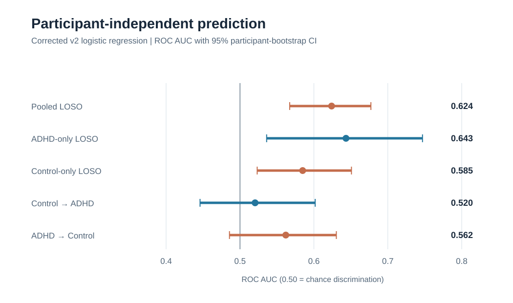
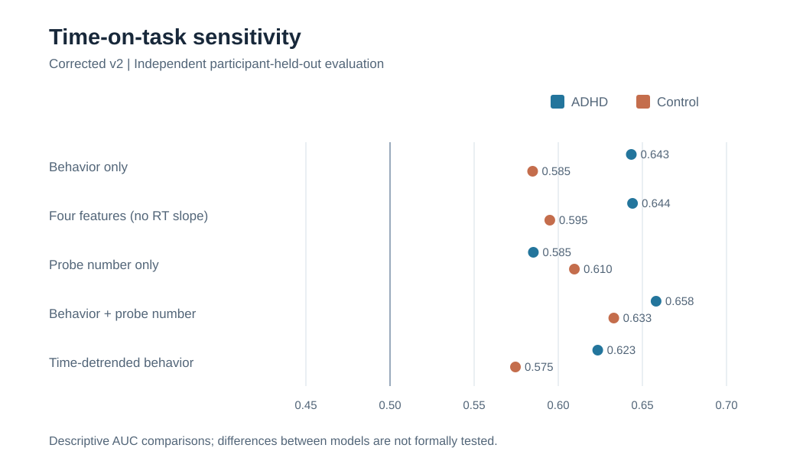

# Predicting Mind-Wandering from SART Behavior Across Individuals

Can short-term changes in task performance help predict when someone is mind-wandering? More importantly, do those patterns remain useful for people who were not included in model training?

This independent research project explores those questions using the Sustained Attention to Response Task (SART) portion of the [ATTLAPSE dataset](https://doi.org/10.5281/zenodo.23592484). The analysis includes **840 thought probes from 56 adults** (28 in the ADHD cohort and 28 controls). Its focus is participant-independent prediction and generalization across cohorts, rather than clinical diagnosis.

## Study design

Each thought probe was paired with an associated short behavioral window. The primary models used five measures of task performance: median reaction time, reaction-time variability, reaction-time slope, omission rate, and commission rate. The outcome was on-task attention versus mind-wandering, with deliberate and spontaneous mind-wandering combined.

A class-weighted logistic regression model was evaluated using **leave-one-participant-out (LOSO) validation**, with standardization fitted only on training data in each fold. I evaluated pooled prediction, prediction within each cohort, and transfer between cohorts in both directions. Participant-level bootstrapping, within-participant label permutations, and sensitivity analyses were used to examine the stability of the results.

## Results

The current analysis uses corrected ATTLAPSE attention-state scoring. ROC AUC estimates and 95% participant-bootstrap confidence intervals are shown below.

| Evaluation | ROC AUC | 95% CI |
| --- | ---: | --- |
| Pooled LOSO | **0.624** | 0.567–0.677 |
| ADHD-only LOSO | **0.643** | 0.536–0.747 |
| Control-only LOSO | **0.585** | 0.523–0.651 |
| Train on controls, test on ADHD | **0.520** | 0.446–0.602 |
| Train on ADHD, test on controls | **0.562** | 0.486–0.630 |

The behavioral features showed **modest discrimination** for participants who had not been seen during training. Cross-cohort transfer was weaker descriptively, but paired comparisons did not establish statistically significant differences between within-cohort and transfer performance. Within-participant label-permutation tests gave empirical p-values of 0.001 for ADHD and 0.016 for controls under the specified exchangeability null.



### Accounting for time-on-task

Probe number alone contained predictive information, particularly among controls. Adding behavioral features to probe number increased pooled ROC AUC from **0.588 to 0.643**, a paired improvement of **0.054** (95% participant-bootstrap CI 0.007–0.099). The analogous confidence intervals for ADHD and control participants separately included zero.

This is an important qualification: the findings do not establish that the behavioral features capture an attention-specific mechanism independent of task progression.



A reduced feature set and a linear support vector machine yielded broadly similar performance. A separate exploratory analysis distinguishing deliberate from spontaneous mind-wandering was near chance (AUC approximately 0.52).

[Attention-state counts](figures/v2_state_distribution.svg) · [Exploratory subtype results](figures/v2_subtype_exploratory.svg) · [All aggregate results](results/)

## Scoring and interpretation

The corrected behavioral metadata assigns scores below 43 to on-task attention, scores 43–52 to deliberate mind-wandering, and scores above 52 to spontaneous mind-wandering. Applying these definitions changed **17 of the 840 probe labels** relative to an earlier analysis. All model results presented here use the corrected labels.

The sample is modest, the labels come from self-reported thought probes in one task, and the models have not been tested on an independent external dataset. The observed patterns should not be treated as diagnostic markers or evidence of causality. More detail on cohort definitions, statistical procedures, uncertainty, and outstanding analyses is provided in [Methods](docs/methods.md).

## Code and reproducibility

| Folder | Contents |
| --- | --- |
| [`scripts/`](scripts/) | Corrected-label modeling, permutation tests, robustness checks, incremental time analysis, and figure generation |
| [`results/`](results/) | Aggregate corrected results and uncertainty estimates |
| [`figures/`](figures/) | Corrected summary visualizations |
| [`docs/`](docs/) | Methods, data provenance, and reproduction instructions |
| [`tests/`](tests/) | Automated synthetic-data validation |

To install the pinned dependencies and run the synthetic-data checks using Python 3.14:

```bash
python3 -m pip install -r requirements.txt
python3 tests/smoke_v2_pipeline.py
```

The corrected analysis scripts and figure generator passed [automated validation](https://github.com/fkeshavarzieng/mw-adhd-attention-generalization/actions/runs/46029776664) on a fresh checkout. The participant-level ATTLAPSE dataset and derived feature table are **not included**. The public repository also does **not** independently reproduce the complete raw-trial-to-feature extraction; some secondary sensitivity checks remain unfinished. See [Reproducibility](docs/reproducibility.md) for the precise input requirements, run commands, and limitations.

## Data attribution and license

This project is an independent secondary analysis of:

Horáková, G., Weibel, S., Tissot, U., Pham, B.-T., Costache, M. E., & Bonnefond, A. (2026). *ATTLAPSE: Behavioral and EEG data of ADHD patients and neurotypical controls during a Go/No-Go task with embedded thought-probes* (Version 2.0.1) [Dataset]. Zenodo. [doi:10.5281/zenodo.23592484](https://doi.org/10.5281/zenodo.23592484).

ATTLAPSE is provided under [CC BY 4.0](https://creativecommons.org/licenses/by/4.0/). The original participant data are not redistributed here. The repository's [MIT License](LICENSE) covers the original analysis code, not the underlying dataset.
